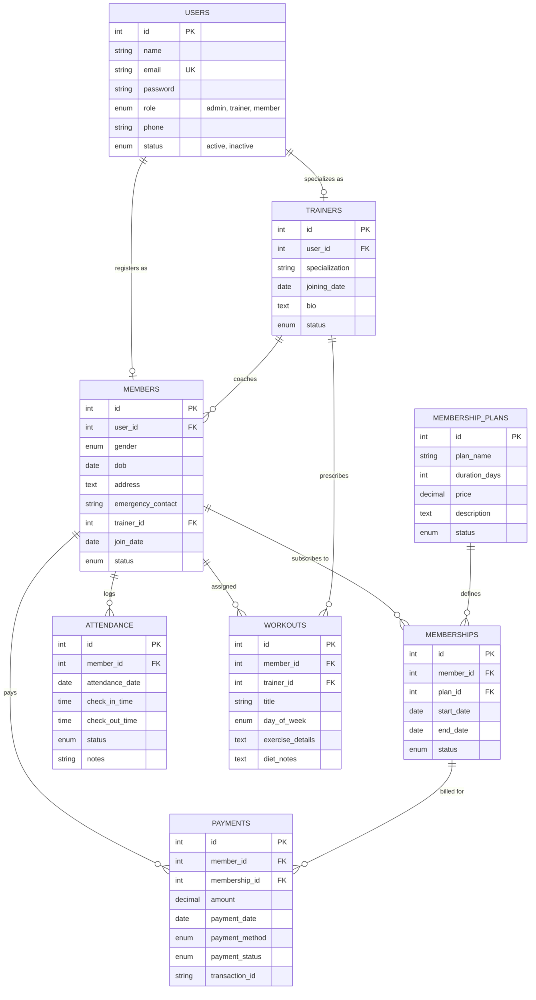

# Gym Management System (IronPulse)

An enterprise-ready, practical, and clean **Gym Management Web Application** designed as an academic project for a **3rd-Year B.E. Computer Science & Engineering** student college demonstration and viva examination.

---

## 1. Technology Stack

* **Frontend**: HTML5, CSS3, Bootstrap 5.3, FontAwesome 6 Icons, Vanilla JavaScript
* **Backend**: PHP 8+ (Pure procedural & modular architecture with PDO)
* **Database**: MySQL 8+ / MariaDB (Normalized Relational Schema with Foreign Key Constraints)
* **Local Development Server**: XAMPP (Apache + MySQL)
* **Production Deployment**: AWS EC2 (Ubuntu 22.04/24.04 LTS + Apache2)

> **Architectural Note**: This project strictly avoids heavy external frameworks (no Laravel, React, Node.js, Python, or MongoDB). Everything is built using native PHP 8 and standard web technologies, making it straightforward to explain during code walkthroughs and viva questions.

---

## 2. System Architecture & Entity-Relationship (ER) Diagram



---

## 3. Role-Based Features

### 👑 Administrator (`admin/`)
* **Secure Authentication**: Session-based login with bcrypt verification and auto-rehash.
* **Dashboard Overview**: 6 Live metric cards (Total Members, Active Members, Total Trainers, Active Memberships, Today's Attendance, Total Revenue) and recent activity tables.
* **Member CRUD**: Register members, assign trainers, edit info, delete with cascade confirmation, search, and filter by gender and status.
* **Trainer CRUD**: Add coaches, assign specializations, view assigned client rosters, edit or delete trainers.
* **Membership Plans**: Define plan packages with custom durations in days (e.g. 30, 90, 180, 365 days) and pricing.
* **Subscription Engine**: Assign membership plans to members with automated end-date calculation and optional 1-click immediate payment recording.
* **Attendance Management**: Mark attendance, record check-in and check-out timestamps, track on-floor workout status, and filter by date.
* **Payments & Billing**: Record fee transactions across multiple payment methods (Cash, Card, UPI, Net Banking) and generate print-ready official tax invoices/receipts.
* **Workout Master View**: Monitor all workout allocations across trainers.
* **Operational Reports**: Visual summaries of revenue by payment mode, plan sales, and monthly attendance distributions.

### 🏋️ Personal Trainer (`trainer/`)
* **Trainer Dashboard**: Overview of assigned active trainees and workout routines.
* **Assigned Members**: Access detailed client profiles, contact numbers, and health records.
* **Workout Management**: Prescribe customized exercise schedules (exercises, sets, reps) and nutritional diet notes for each day of the week.
* **Client Workout History**: Update or modify routines as clients progress.

### 🏃 Gym Member (`member/`)
* **Personal Portal**: View current active membership badge, days remaining countdown, and progress bar.
* **Trainer Profile**: View assigned personal coach's contact and specialization details.
* **Daily Workout Schedule**: Inspect today's routine and weekly exercise breakdowns.
* **Attendance Log**: Review personal gym visits, check-in timestamps, and session durations.
* **Payment History**: View all billing records and download/print official payment receipts.
* **Profile Management**: Update contact details, emergency contacts, and account passwords.

---

## 4. Default Demo Accounts for College Viva

The login page includes **1-Click Quick-Fill buttons** so you can instantly log in during your college demonstration without typing credentials:

| Role | Email Address | Password | Description |
| :--- | :--- | :--- | :--- |
| **Admin** | `admin@gym.com` | `admin123` | Full administrative control |
| **Trainer** | `alex@gym.com` | `trainer123` | Strength & Conditioning Coach |
| **Trainer** | `sarah@gym.com` | `trainer123` | Yoga & Pilates Coach |
| **Trainer** | `mike@gym.com` | `trainer123` | CrossFit & Boxing Coach |
| **Member** | `john@gmail.com` | `member123` | Active VIP Member (Assigned to Alex) |
| **Member** | `emily@gmail.com` | `member123` | Active Pro Member (Assigned to Sarah) |
| **Member** | `rahul@gmail.com` | `member123` | Active Starter Member (Assigned to Alex) |

---

## 5. Local Setup Guide (Windows + XAMPP)

### Step 1: Install XAMPP
1. Download and install **XAMPP** (with PHP 8.x and MySQL) from [apachefriends.org](https://www.apachefriends.org/).
2. Open the **XAMPP Control Panel** and start **Apache** and **MySQL**.

### Step 2: Copy Project Files
Copy or move the `gym-management-system` folder into the `htdocs` directory of your XAMPP installation:
```text
C:\xampp\htdocs\gym-management-system\
```

### Step 3: Import the Database
1. Open your web browser and navigate to: `http://localhost/phpmyadmin/`
2. Click **New** on the left navigation panel, create a database named: `gym_management`
3. Click on the newly created `gym_management` database, select the **Import** tab at the top.
4. Click **Choose File** and select:
   ```text
   C:\xampp\htdocs\gym-management-system\database\schema.sql
   ```
5. Click **Import** (or **Go** at the bottom). All tables and seed data will be created instantly.

### Step 4: Access the Application
Open your browser and visit:
* Public Landing Page: `http://localhost/gym-management-system/`
* Portal Login: `http://localhost/gym-management-system/login.php`

---

## 6. AWS EC2 (Ubuntu) Production Deployment Guide

Deploying on an AWS EC2 instance is a major highlight for a 3rd-year CS project. Follow these steps:

### Step 1: Launch an EC2 Instance
1. Log into your **AWS Management Console**.
2. Navigate to **EC2** &rarr; **Launch Instance**.
3. Choose **Ubuntu Server 22.04 LTS** or **24.04 LTS** (64-bit x86).
4. Instance Type: `t2.micro` or `t3.micro` (AWS Free Tier eligible).
5. Key Pair: Select or create an SSH key pair (e.g., `gym-key.pem`).
6. **Network & Security Groups**: Ensure the following inbound rules are enabled:
   * **SSH** (Port 22) - Source: Anywhere (or your IP)
   * **HTTP** (Port 80) - Source: Anywhere (`0.0.0.0/0`)
   * **HTTPS** (Port 443) - Source: Anywhere (`0.0.0.0/0`)
7. Click **Launch Instance**.

### Step 2: Connect via SSH
Open your terminal (or PowerShell / Git Bash) on your computer:
```bash
chmod 400 gym-key.pem
ssh -i "gym-key.pem" ubuntu@<YOUR-EC2-PUBLIC-IP>
```

### Step 3: Run the Automated Deployment Script
Transfer the project files to the EC2 server or run:
```bash
# Clone or upload your project to the server
cd /home/ubuntu
# Make the deployment script executable and run it
chmod +x ec2-setup.sh
./ec2-setup.sh
```

### Step 4: Manual Step-by-Step Configuration (If preferred over script)
```bash
# 1. Update system packages
sudo apt update && sudo apt upgrade -y

# 2. Install Apache, MySQL Server, and PHP 8
sudo apt install apache2 mysql-server php libapache2-mod-php php-mysql php-mbstring php-xml php-curl -y

# 3. Create MySQL Database & User
sudo mysql
```
Inside MySQL shell:
```sql
CREATE DATABASE gym_management CHARACTER SET utf8mb4 COLLATE utf8mb4_unicode_ci;
CREATE USER 'gym_user'@'localhost' IDENTIFIED BY 'GymSecurePass2026!';
GRANT ALL PRIVILEGES ON gym_management.* TO 'gym_user'@'localhost';
FLUSH PRIVILEGES;
EXIT;
```
Import schema:
```bash
sudo mysql gym_management < /var/www/html/gym-management-system/database/schema.sql
```
Set proper ownership:
```bash
sudo chown -R www-data:www-data /var/www/html/gym-management-system
sudo chmod -R 755 /var/www/html/gym-management-system
sudo systemctl restart apache2
```
Now access `http://<YOUR-EC2-PUBLIC-IP>/gym-management-system/` in any browser!

---

## 7. College Viva Questions & Technical Answers (B.E. CSE)

Use these 25 curated questions and expert answers to excel in your project examination and viva:

### Database & Relational Modeling

#### Q1: What database normal form does this project satisfy?
**Answer**: The database is normalized up to **3rd Normal Form (3NF)**:
* **1NF**: Every column contains atomic values, each record has a unique primary key, and there are no repeating groups.
* **2NF**: It is in 1NF, and all non-key attributes are fully functionally dependent on the entire primary key (no partial dependencies).
* **3NF**: It is in 2NF, and there are no transitive dependencies (non-prime attributes depend only on the primary key, not on other non-prime attributes). For instance, user credentials and authentication reside in `users`, while gym-specific attributes reside in `members` and `trainers` via foreign key relationships.

#### Q2: What is the difference between `DELETE CASCADE` and `SET NULL` in foreign keys?
**Answer**: 
* **`ON DELETE CASCADE`**: When a record in the parent table is deleted, all corresponding records in the child table are automatically deleted. In this project, deleting a user account cascades and removes their member profile.
* **`ON DELETE SET NULL`**: When the parent record is deleted, the foreign key column in the child table is set to `NULL`. In this project, if a trainer is deleted, `members.trainer_id` is set to `NULL`, so members do not lose their accounts when their coach leaves.

#### Q3: Why did you separate `users`, `members`, and `trainers` into distinct tables instead of a single table?
**Answer**: This follows the **table inheritance pattern (Subtype/Supertype)**. A single table would lead to numerous `NULL` values (sparse table problem) because members do not have a "specialization" or "bio", and trainers do not have "emergency contacts" or "membership expiry dates". Separating them maintains data integrity, reduces memory overhead, and allows clean indexing.

#### Q4: How is membership expiration handled?
**Answer**: Expiration is calculated both dynamically and synchronized:
1. `memberships.end_date` is calculated by adding the plan's duration (in days) to `start_date`:
   $$\text{end\_date} = \text{start\_date} + \text{duration\_days}$$
2. The helper function `sync_membership_statuses($pdo)` executes an update query:
   ```sql
   UPDATE memberships SET status = 'expired' WHERE status = 'active' AND end_date < CURDATE();
   ```
   This ensures status values remain consistent in reports and queries.

---

### Backend & PHP 8

#### Q5: Why did you choose PDO over MySQLi or the deprecated `mysql_*` functions?
**Answer**:
1. **Database Portability**: PDO supports 12 different database drivers (MySQL, PostgreSQL, SQLite, Oracle), whereas MySQLi only works with MySQL.
2. **Prepared Statements**: PDO forces clean separation of SQL query logic from data input using parameterized statements, completely eliminating SQL Injection vulnerabilities.
3. **Robust Error Handling**: PDO provides `PDO::ERRMODE_EXCEPTION`, allowing standard `try...catch` block management.
4. **Named and Positional Placeholders**: PDO supports both `?` and `:param_name` placeholders.

#### Q6: How does this project prevent SQL Injection attacks?
**Answer**: Every dynamic query uses PDO prepared statements with parameter binding:
```php
$stmt = $pdo->prepare("SELECT * FROM users WHERE email = ? LIMIT 1");
$stmt->execute([$email]);
```
User inputs are never concatenated directly into SQL query strings. The database driver treats the parameters strictly as data literals, never executable SQL commands.

#### Q7: How are passwords stored and verified securely?
**Answer**:
Passwords are encrypted using PHP's native `password_hash($password, PASSWORD_BCRYPT)` function:
* It generates a salted hash using the Blowfish algorithm with adaptive work factor (cost).
* A unique cryptographic salt is automatically generated for every password, rendering Rainbow Table attacks useless.
* Passwords are verified using `password_verify($password, $hash)`, which prevents timing attacks.

#### Q8: What is Cross-Site Scripting (XSS) and how is it mitigated here?
**Answer**: XSS occurs when malicious JavaScript code is injected into the application and executed in the browser of other users. In this project, all user-supplied data rendered into HTML is sanitized using `htmlspecialchars($data, ENT_QUOTES, 'UTF-8')`.

#### Q9: How does session management work in this system?
**Answer**:
* `session_start()` initializes a session on the server.
* The server sends a unique, randomized `PHPSESSID` cookie to the user's browser.
* User identity (`user_id`, `role`, `user_name`) is stored server-side in `$_SESSION`.
* Access control guards like `require_role('admin')` verify the role from the server-side session before rendering any view.
* Upon logout, `session_destroy()` invalidates the session and cleans the cookie.

---

### Web Server & Cloud Deployment (Apache & AWS EC2)

#### Q10: What is the role of the Apache Web Server?
**Answer**: Apache is an HTTP web server that listens on port 80 (HTTP) and 443 (HTTPS). When a browser makes a request:
1. Apache receives the request.
2. Apache passes requests for `.php` files to the PHP module (`libapache2-mod-php` or PHP-FPM).
3. PHP executes the script, queries MySQL, and returns standard HTML/CSS/JS back to Apache.
4. Apache sends the HTTP response back to the client browser.

#### Q11: What are AWS Security Groups and how do they function?
**Answer**: A Security Group acts as a virtual stateful firewall for an EC2 instance to control incoming and outgoing traffic:
* **Port 22 (SSH)**: Allows administrators to securely shell into the Ubuntu server.
* **Port 80 (HTTP)**: Allows web visitors to access the website.
* **Port 443 (HTTPS)**: Allows encrypted TLS/SSL web traffic.
* Since Security Groups are **stateful**, any inbound rule automatically permits return response traffic.

#### Q12: What is the difference between a Public IP and an Elastic IP in AWS EC2?
**Answer**:
* A standard **Public IPv4 address** assigned to an EC2 instance changes every time the instance is stopped and started.
* An **Elastic IP (EIP)** is a reserved, static public IPv4 address allocated to your AWS account that remains constant across restarts, ensuring uninterrupted domain binding for web applications.

---

## 8. Folder & File Structure

```text
gym-management-system/
├── admin/                     # Administrator pages
│   ├── attendance.php         # Check-in & check-out logs and filters
│   ├── dashboard.php          # 6 KPI cards, recent members/payments/attendance
│   ├── member_add.php         # New member registration
│   ├── member_delete.php      # Member deletion handler
│   ├── member_edit.php        # Member edit form
│   ├── members.php            # Member directory & search
│   ├── member_view.php        # Comprehensive tabbed member profile
│   ├── membership_assign.php  # Assign plan with auto-calculated end date
│   ├── memberships.php        # Active & past subscriptions ledger
│   ├── payment_add.php        # Fee payment entry form
│   ├── payment_receipt.php    # Official print-ready tax invoice
│   ├── payments.php           # Billing ledger & revenue breakdown
│   ├── plan_add.php           # Create membership plan
│   ├── plan_delete.php        # Safe plan deletion check
│   ├── plan_edit.php          # Modify plan
│   ├── plans.php              # Membership plan catalog
│   ├── reports.php            # Summary analytics & charts
│   ├── trainer_add.php        # Coach registration
│   ├── trainer_delete.php     # Delete coach handler
│   ├── trainer_edit.php       # Coach edit form
│   ├── trainer_view.php       # Coach bio and assigned client list
│   ├── trainers.php           # Coach directory
│   └── workouts.php           # Master workout routine viewer
├── assets/
│   ├── css/
│   │   └── custom.css         # Modern athletic gym theme & print stylesheet
│   └── js/
│       └── main.js            # Auto-date calculator & delete confirm modals
├── config/
│   ├── config.php             # Global bootstrap, constants, CSRF, flash alerts
│   └── database.php           # PDO database connection with fallback screen
├── database/
│   └── schema.sql             # MySQL schema with FK constraints & seed data
├── includes/
│   ├── auth_guard.php         # Role-based middleware & route protection
│   ├── footer.php             # Shared layout footer & JavaScript bundle
│   ├── functions.php          # Reusable helpers & status badges
│   ├── header.php             # Shared top navbar & user badge
│   └── sidebar.php            # Dynamic role-based navigation sidebar
├── member/                    # Gym Member pages
│   ├── attendance.php         # Personal attendance history & statistics
│   ├── dashboard.php          # Member overview & current subscription badge
│   ├── membership.php         # Plan details, progress bar, renewal history
│   ├── payments.php           # Billing records & receipt downloads
│   ├── profile.php            # Personal contact & password update
│   └── workouts.php           # Weekly exercise routine & diet notes
├── trainer/                   # Personal Trainer pages
│   ├── dashboard.php          # Coach metrics & recent workouts
│   ├── member_view.php        # Trainee fitness profile & workout history
│   ├── members.php            # Assigned trainees directory
│   ├── workout_add.php        # Prescribe exercise & diet plan
│   ├── workout_edit.php       # Update exercise & diet routine
│   └── workouts.php           # Workout plans management
├── ec2-setup.sh               # 1-Click automated AWS EC2 Ubuntu installer
├── index.php                  # Public landing page with plans & coaches
├── login.php                  # Unified login with 1-Click Demo Fillers
├── logout.php                 # Safe session destruction
└── README.md                  # Comprehensive Documentation & Viva Guide
```

---

## 9. Academic Declaration
This project is developed for academic presentation in Bachelor of Engineering (B.E.), Computer Science & Engineering. All database relations and authentication procedures adhere to standard software engineering and web application security best practices.
